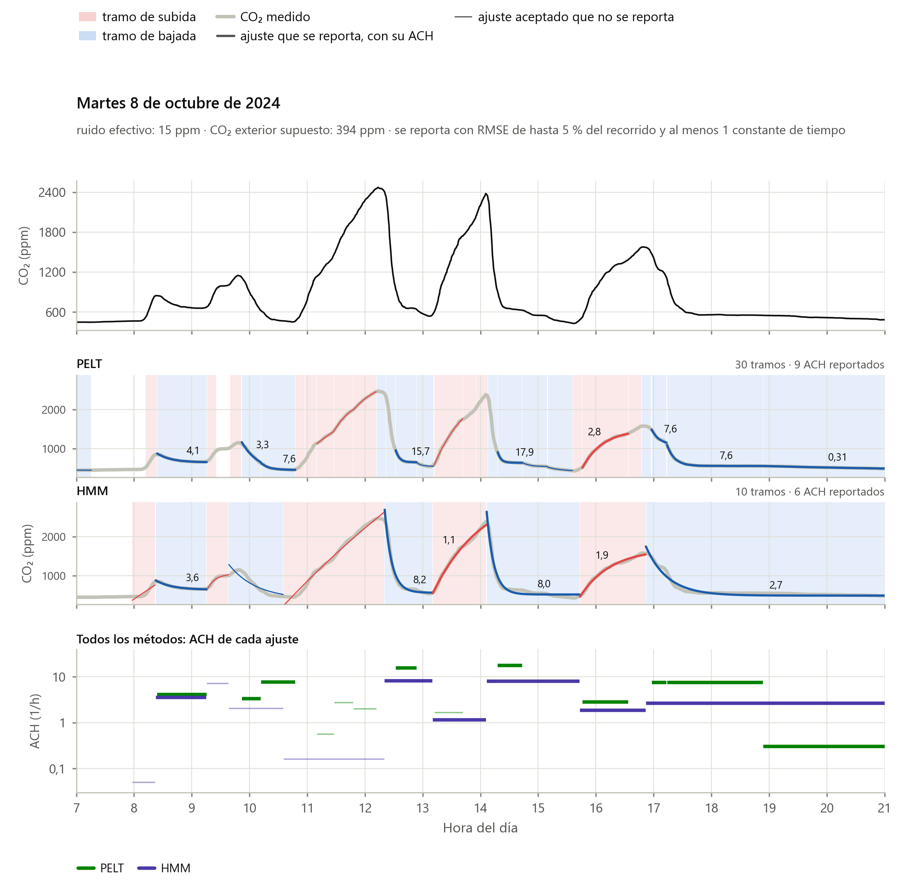

# Guía de `co2ach`

Dos partes:

- **Segmentación y ACH** (`co2ach.ach`): corta cada día en tramos de subida y bajada, les ajusta la exponencial del balance de masa y estima la ACH de cada evento y de cada día. Si sabés el horario del salón y quiénes lo ocupan, lo usa.
- **Pronóstico** (`co2ach.pronostico`): entrena un modelo que pronostica el CO₂ de 1 a 60 minutos, con un intervalo del 80 % y la probabilidad de pasar 1000 ppm.

Es el código de los capítulos 4 a 8 de la tesis. El detalle de cada función está en [docs/referencia.md](docs/referencia.md).

## Instalación

Python 3.10 o más nuevo. En la carpeta del repo:

```bash
pip install -e .
```

Con `-e` los cambios en el código se ven sin reinstalar. Se instalan también numpy, scipy, pandas, scikit-learn, ruptures, hmmlearn, joblib, lightgbm, matplotlib, pyarrow y h5py. En Windows, si pip no puede escribir en la carpeta de Python, agregá `--user`.

## Los datos

Todo recibe las lecturas de un salón como una tabla de pandas, una fila por lectura:

| tiempo | co2 | temp | hum |
|---|---|---|---|
| 2024-10-08 08:00:12 | 612 | 21.3 | 48 |
| 2024-10-08 08:00:44 | 615 | 21.3 | 48 |

`tiempo` y `co2` [ppm] son obligatorias; `temp` [°C] y `hum` [%] sólo las usa el pronóstico. Si tus columnas se llaman distinto: `co2ach.prepare_readings(tabla, time_col="fecha", co2_col="CO2")`. Para los CSV mensuales del proyecto está `co2ach.read_room(carpeta, ip, id)`.

## Segmentación y ACH

### Un día

```python
import co2ach

lecturas = co2ach.read_room("mediciones", "Escuelas32y83", 2)
dia = co2ach.segment_day(lecturas, "2024-10-08", methods=("hmm", "pelt"))

dia.reported()       # los eventos con una ACH confiable
dia.events           # todos los ajustes, con su calidad
dia.plot(path="dia.png")
```

Cada fila de `dia.events` es un tramo ajustado por un método: cuándo empieza y termina, si es subida o bajada, la ACH [1/h] con su error estándar, la asíntota, la calidad del ajuste y si se reporta. Se reporta si la curva se parece a una exponencial (RMSE de hasta 5 % de su recorrido) y el tramo dura al menos una constante de tiempo, que es lo que hace falta para que la ACH quede determinada.



### Un salón entero

```python
analisis = co2ach.analyze_room(
    lecturas,
    methods=("hmm", "pelt"),
    occupancy=co2ach.Occupancy.parse(["00:00-07:45", "10:00-10:30", "12:00-13:00", "15:00-15:30", "17:15-24:00"]),
    groups={
        "bajo": co2ach.Group(children=20, age=9, mass_kg=31.9, met=1.0, teacher_met=1.6),
        "medio": co2ach.Group(children=25, age=9, mass_kg=31.9, met=1.2, teacher_met=1.6),
        "alto": co2ach.Group(children=30, age=9, mass_kg=31.9, met=1.4, teacher_met=1.6),
    },
    volume_m3=168,
    n_jobs=4,
)
analisis.events   # los ajustes de todos los días, con los reajustes
analisis.daily    # la ACH de cada día, ponderada por la duración de los eventos
analisis.blocks   # la ACH de cada día y bloque del horario
analisis.plot_day("2024-10-08")
```

- Sin `occupancy` ni `groups` la asíntota de cada curva queda libre: no hace falta saber nada del aula, pero en las subidas la ACH queda mal determinada.
- Con el **horario** (`occupancy`), las bajadas con el aula vacía se reajustan con la asíntota en el CO₂ exterior (columna `ach_puro`).
- Con los **casos de generación** (`groups`) y el **volumen**, los tramos con la clase adentro se reajustan con cada caso (`ach_bajo`, `ach_medio`, `ach_alto`) y con la generación libre entre el menor y el mayor (`ach_acotada`).

`co2ach.THESIS_SCHEDULE` y `co2ach.THESIS_CLASS` son el horario y los tres casos del salón A02.

### Una serie cualquiera o un intervalo a mano

```python
r = co2ach.segment(tabla["tiempo"], tabla["co2"], c_ext=420, methods="pelt")   # un ensayo, una simulación
f = co2ach.fit_event(lecturas, "2024-10-08 12:20", "2024-10-08 13:00", c_ext=394, model="vacio")
f["ach"], f["ach_se"]
```

`fit_event` tiene cuatro modelos: `"libre"`, `"vacio"` (asíntota en el CO₂ exterior), `"conocida"` (con la fuente S = G/V) y `"acotada"` (la fuente entre dos valores).

### Qué método usar

| Nombre | Cuándo |
|---|---|
| `"hmm"` (por defecto) | Mediciones reales: fue el que mejor reprodujo la segmentación a mano y la ACH diaria |
| `"pelt"` | Series que siguen bien el modelo (laboratorio, simulaciones) |
| `"derivada"` | Alternativa sencilla: en sintéticas casi iguala a PELT; en mediciones fragmenta más que el HMM |
| `"hyun"`, `"hyun_decaimientos"`, `"hyun_c2"`, `"hyun_quiebres"` | El método de Hyun (2025) y sus variantes, para comparar |

Correr dos o tres métodos y fijarse si coinciden es una buena forma de encontrar los eventos dudosos.

## Pronóstico

```python
import co2ach

salones = {
    "A02": co2ach.read_room("mediciones", "Escuelas32y83", 2),
    "A06": co2ach.read_room("mediciones", "Escuelas32y83", 6),
}
modelo = co2ach.Forecaster.train(salones)        # LightGBM, un modelo por horizonte
modelo.metrics                                   # el error en los días de prueba
modelo.save("modelos/escuela_a")

modelo = co2ach.Forecaster.load("modelos/escuela_a")
p = modelo.predict(lecturas_hasta_ahora, room="A02")   # desde el último minuto con dato
```

`p` tiene una fila por horizonte (1, 5, 10, 15, 20, 25, 30, 45 y 60 min) con el CO₂ pronosticado, el intervalo del 80 %, la probabilidad de estar arriba de 1000 ppm y la de cruzarlo antes de ese momento.

- **Partición.** Por defecto, en cada mes: días 1 a 15 para entrenar, 16 a 19 para la detención temprana, 20 a 23 para calibrar el intervalo y del 24 a fin de mes para medir el error. Con `split=` podés usar otra.
- **Variables.** CO₂ reciente, hora y día, temperatura y humedad, historia del salón y el salón. Sin temperatura y humedad: `variables=("co2", "calendario", "historia", "salon")`.
- **Salones nuevos.** Un modelo entrenado con varios salones se puede usar en uno que no vio (sin `room=`); pasale al menos la última semana de lecturas.
- **Referencias.** `co2ach.persistence_forecast` y `co2ach.mass_balance_forecast` no necesitan entrenamiento.

En la tesis, con 32 salones, el error absoluto medio fue de 106 ppm a 15 min y de 298 ppm a 60 min.

## Cosas a tener en cuenta

- **El CO₂ exterior** se estima de la propia serie (el mínimo semanal del percentil 1 diario), así que las lecturas tienen que incluir noches o fines de semana con el aula vacía.
- **Sin saber nada de la ocupación, las subidas no determinan bien la ACH.** Usá sólo los eventos reportados y, si podés, el horario y la generación de la clase.
- **La generación es lo que más pesa en la incertidumbre.** Entre 20 y 30 escolares la ACH con la clase adentro cambia en un factor de tres; registrar la asistencia ayuda mucho.
- **Un sensor mide su entorno.** Con la ventilación abierta, la ACH depende de dónde esté el sensor respecto de la entrada de aire (sección 5.2).
- **Los parámetros de los métodos** son los de la tesis, pensados para lecturas cada 30 s y eventos de decenas de minutos.

## Versiones

| Versión | Cambios |
|---|---|
| 0.2.0 | Primera versión para el grupo: `co2ach.ach` y `co2ach.pronostico`, régimen completo, generación acotada, ACH diaria ponderada por duración |
| 0.3.0 | Queda sólo lo que está en la tesis; el paquete pasa a la carpeta `co2ach/` con su `pyproject.toml` |
